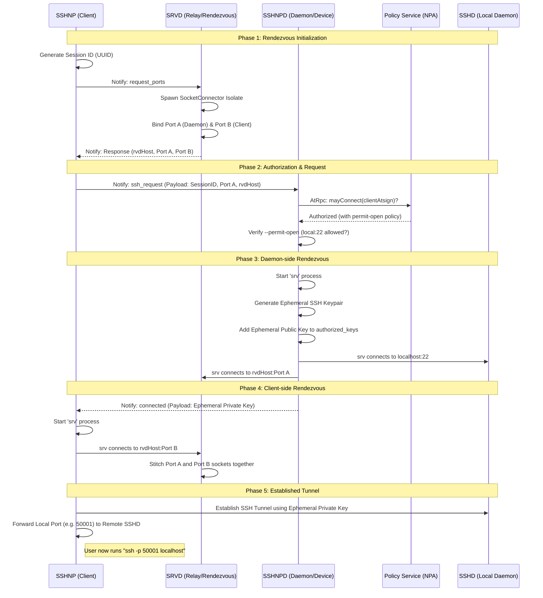

# SSHNP to SSHNPD Connection Sequence

This document describes the in-depth handshake and connection establishment process between the `sshnp` client and the `sshnpd` daemon within the NoPorts ecosystem.

## High-Level Architecture

The connection is orchestrated using the **@platform** for control signaling and a **Socket Rendezvous (SRVD)** service for data transport. This architecture allows secure connections even when both parties are behind NAT or firewalls, as all connections are outbound-only.

## Connection Flow Diagram

## Detailed Component Breakdown

### 1. Socket Rendezvous (SRV/SRVD)
The `srvd` service acts as a transparent "matchmaker". 
- **Dynamic Port Allocation**: `srvd` allocates a unique pair of ports (Port A and Port B) for every session.
- **Socket Stitching**: It spawns a background isolate (process) that waits for connections on both ports. Once both the daemon (Side A) and client (Side B) have connected, it pipes the data streams between them.
- **Isolate Safety**: Each session runs in its own isolate, ensuring that one session's failure or high traffic does not impact others.

### 2. End-to-End Encryption (E2EE)
When `encryptRvdTraffic` is enabled, a secondary layer of encryption is applied at the socket level:
- **Key Exchange**: The client provides an ephemeral public key in the initial `@platform` notification.
- **Session Keys**: The daemon generates AES-GCM keys for the session, encrypts them with the client's public key, and sends them back in the `connected` notification.
- **Transparent Wrapping**: Both the client and daemon `srv` processes wrap the raw socket traffic in this encrypted layer before it reaches the `srvd` relay. This ensures that even the relay operator cannot inspect the traffic.

### 3. Authentication & Authorization
- **Identity Verification**: All signaling happens over the `@platform`, which cryptographically guarantees that the `ssh_request` actually came from the atSign it claims to be from.
- **NPA (No Ports Authorization)**: The daemon can optionally delegate the "Can this user connect?" decision to a central Policy Service. This allows for complex policies based on time, location, or user groups.
- **Local Policy**: Even after NPA approval, the daemon checks its local `--permit-open` list to ensure the requested destination (typically `localhost:22`) is allowed.

### 4. Ephemeral Key Management
To avoid persistent security risks, the daemon manages keys on-the-fly:
- **Generation**: A one-time-use SSH keypair is generated for every session.
- **Restriction**: The public key is added to `~/.ssh/authorized_keys` with a mandatory `permitopen` clause, preventing the tunnel from being used for lateral movement within the network.
- **Auto-Cleanup**: A 15-second timer is started as soon as the key is added. If the client doesn't connect within this window, the key is purged. It is also purged immediately after a successful session starts.

### 5. Double Encryption (The SSH Tunnel)
In standard mode, the connection uses "Double SSH":
1. **Outer Tunnel**: Created using the ephemeral key. Its only purpose is to provide a secure "pipe" from the client's localhost to the daemon's localhost.
2. **Inner Tunnel**: The user's actual SSH session (shell, file transfer, etc.) runs *inside* the outer tunnel. This ensures the user's long-term identity keys and sensitive data are never visible to the relay or the ephemeral session.
